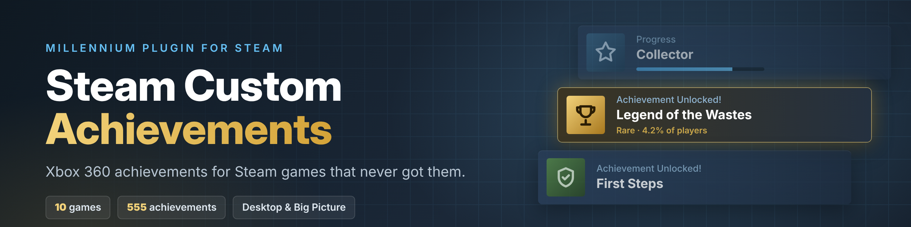

<p align="center">
  
</p>

<p align="center">
  <a href="https://github.com/GNRRaiser/Steam-Custom-Achievements/releases"></a>
  <a href="https://github.com/GNRRaiser/Steam-Custom-Achievements/releases/latest"></a>
  <a href="https://github.com/GNRRaiser/Steam-Custom-Achievements/actions/workflows/tests.yml"></a>
  <a href="LICENSE"></a>
</p>

# Steam Custom Achievements: Xbox 360 achievements for Steam games that have none

**Steam achievements for Mass Effect, Mass Effect 2, Assassin's Creed, Assassin's Creed II, Assassin's Creed Brotherhood, Call of Duty 4: Modern Warfare, Call of Duty: World at War, Fable III, Fallout 3 and Thrillville: Off the Rails.**

These PC games never got achievements on Steam, even though their Xbox 360 and PS3 versions had them (several had Games for Windows Live achievements that are gone now). Steam Custom Achievements is a free [Millennium](https://steambrew.app) plugin that adds them back: each game gets an ACHIEVEMENTS card on its Steam Library page, an ACHIEVEMENTS stat next to PLAY TIME, unlock popups, and a full "View My Achievements" list, in desktop Steam and Big Picture mode.

Most achievements unlock by themselves: the plugin reads the game's saves (read-only) and unlocks an achievement a few seconds after the game records the progress, including ones you earned before installing. The rest have a "Mark as unlocked" button.

It looks and works like Steam's own achievements:

- **Unlock rates:** every achievement shows how many players have it (for example "63% of players have this achievement"), from the real Xbox 360 percentages. You can sort by rarest or most common.
- **Rare glow:** unlocked achievements that fewer than 10% of players have get Steam's gold glow.
- **Hidden achievements:** locked story achievements stay hidden until you unlock them. **Show spoilers** reveals them.
- **Progress popups:** achievements with a counter (feathers, kills and so on) show a Steam progress popup at 25%, 50% and 75%.
- **Steam's layout:** a near full-height window with a trophy summary, category counts such as "Broken Steel (2/6)", Steam's date style and pictures up to 256x256.

It's an unofficial fan plugin. The achievements only show in your own Steam client, not on your Steam profile.

- **Website:** https://gnrraiser.github.io/Steam-Custom-Achievements/ (one page per game with the full achievement list)
- **Install guide on Steam:** https://steamcommunity.com/sharedfiles/filedetails/?id=3830564916
- **Download:** [Releases](../../releases)

## Supported games and achievements

The achievements come from each game's Xbox 360 list, plus the PS3 platinum. Mass Effect, Brotherhood and Fable III keep their own achievement list inside the game, which made those much easier to get working. When you unlock one while playing, it pops up in the bottom right corner with a sound, just like a real Steam achievement.

| Game | Steam app ID | Achievements | Unlock automatically |
| --- | --- | --- | --- |
| [Assassin's Creed Steam achievements](https://gnrraiser.github.io/Steam-Custom-Achievements/assassins-creed/) | 15100 | 44 | 44 |
| [Assassin's Creed II Steam achievements](https://gnrraiser.github.io/Steam-Custom-Achievements/assassins-creed-2/) | 33230 | 51 | 41 |
| [Assassin's Creed Brotherhood Steam achievements](https://gnrraiser.github.io/Steam-Custom-Achievements/assassins-creed-brotherhood/) | 48190 | 61 | 50 |
| [Call of Duty 4: Modern Warfare Steam achievements](https://gnrraiser.github.io/Steam-Custom-Achievements/call-of-duty-4-modern-warfare/) | 7940 | 37 | 24 |
| [Call of Duty: World at War Steam achievements](https://gnrraiser.github.io/Steam-Custom-Achievements/call-of-duty-world-at-war/) | 10090 | 67 | 22 |
| [Fable III Steam achievements](https://gnrraiser.github.io/Steam-Custom-Achievements/fable-3/) | 105400 | 60 | 60 |
| [Fallout 3 Game of the Year Edition Steam achievements](https://gnrraiser.github.io/Steam-Custom-Achievements/fallout-3/) | 22370 | 72 | 72 |
| [Mass Effect Steam achievements](https://gnrraiser.github.io/Steam-Custom-Achievements/mass-effect/) | 17460 | 50 | 45 |
| [Mass Effect 2 Steam achievements](https://gnrraiser.github.io/Steam-Custom-Achievements/mass-effect-2/) | 24980 | 63 | 61 |
| [Thrillville: Off the Rails Steam achievements](https://gnrraiser.github.io/Steam-Custom-Achievements/thrillville-off-the-rails/) | 6080 | 50 | 18 |

Totals include the PS3 platinum where the game has one. [AUTO_TRACKING.md](AUTO_TRACKING.md) explains how automatic unlocks work and what each Assassin's Creed II achievement reads; [CHANGELOG.txt](CHANGELOG.txt) covers the other games.

Unlock rates come from TrueAchievements (the share of tracked players who earned each achievement on Xbox 360). A few World at War Map Pack 3 achievements don't have one yet. To use your own numbers, save a game's achievement page from TrueAchievements or Exophase (Ctrl+S, as .mhtml or .html) and load it in View My Achievements > SETTINGS; it fills in the rates, and a saved .mhtml page also fills in the pictures.

## Install

You need Windows, Steam and [Millennium](https://steambrew.app) 3.x.

1. Download the latest `steam-custom-achievements-vX.Y.Z-share.zip` from [Releases](../../releases).
2. Exit Steam completely (Steam > Exit).
3. Right-click the ZIP and choose Extract All.
4. Open the `steam-custom-achievements` folder and run `INSTALL_OR_REPAIR.cmd`. If Windows warns you, click More info > Run anyway.
5. Start Steam. In Millennium > Plugins, make sure **Steam Custom Achievements (Local)** is turned on.
6. Open a supported game in your Library. The ACHIEVEMENTS section is under Friends Who Play.

To update, repeat steps 1 to 5 with the new ZIP. Your unlocks are kept. `CHECK_INSTALL.cmd` checks an install without changing anything.

Automatic unlocks pop a second or two after the game writes its save. Some games only save at checkpoints, so an unlock can come a little after the moment you earned it.

If nothing unlocks, open View My Achievements > SETTINGS and click Auto-detect save, or paste your save folder's path. The [Steam guide](https://steamcommunity.com/sharedfiles/filedetails/?id=3830564916) covers the common problems.

## Privacy

The plugin makes no network connections. It only reads game saves, never changes them, and only writes to its own plugin folder and Millennium's settings. Only download it from this repo's Releases or the Steam guide.

If you use "Capture while I play" or "Record an achievement", copies of your saves are kept in the plugin's `recordings` folder. Don't zip up your installed plugin folder to share it; share the release ZIP instead.

## Adding a game

Contributions are welcome. A game is one folder, `source/games/<slug>/`, with a `game.json` listing its achievements. The short version:

1. Create `source/games/<slug>/game.json`. Start with `"detector": null` so every achievement is manual (see the example in [ADDING_A_GAME.md](ADDING_A_GAME.md)). `appId` is the number in the game's Steam store URL.
2. Optionally add pictures as `source/games/<slug>/art/<index>.webp` (or `.png`/`.jpg`), numbered in list order from 0.
3. Add the slug to `ORDER` at the top of `source/build.py`.
4. Run `python source/build.py`. It checks the game and regenerates `.millennium/Dist/index.js` and `backend/games.lua`. Then add the game to `ORDER` and `GAME_INFO` in `source/site.py` and run it to make the game's web page. Commit the generated files too.
5. Run the tests (below) and open a pull request.

To make achievements unlock automatically, the plugin needs to understand the game's save. Games on the Call of Duty 4 engine just need rules in `game.json`. A new save format needs a `backend/detector_<name>.lua`. [ADDING_A_GAME.md](ADDING_A_GAME.md) covers both. The golden rule: a detector only reads files, and a save it doesn't fully understand must never unlock anything.

The plugin's record mode (View My Achievements > Settings > Record an achievement) saves your save files before and after you earn an achievement, which is the easiest way to work out where a game stores it. Please don't commit real saves to the repo; describe what changed, or build a small test fixture like the ones in `tests/`.

## Building and testing

Requirements: Python 3, Node.js, `pip install lupa` and `npm install jsdom`.

```sh
python source/build.py                 # regenerate the plugin from source/
python source/site.py                  # regenerate the website in docs/
for t in tests/test_*.py; do python "$t"; done
for t in tests/test_*.cjs; do node "$t"; done
python source/package.py ../steam-custom-achievements-vX.Y.Z-share.zip --share   # release ZIP
```

GitHub runs all of these automatically on every pull request and every push to `main` (`.github/workflows/tests.yml`); the result shows as a green tick or red cross on the PR.

`package.py` must write the ZIP outside the repo folder. For an extra check before sharing, put words that must never ship (your name, Windows username, Steam ID) one per line in `source/private_terms.txt`; that file is git-ignored, and `--share` refuses to build if any of them appear in the package.

## Repo layout

| Path | What it is |
| --- | --- |
| `source/games/<slug>/` | One folder per game: `game.json`, pictures, rule files |
| `source/*.js` | Frontend source (the Library card, popup, settings) |
| `source/build.py`, `source/package.py` | Build the plugin and the release ZIP |
| `backend/` | Lua backend: save watcher and one detector per save format |
| `.millennium/Dist/index.js`, `backend/games.lua` | Generated by `build.py` |
| `tools/Install-Plugin.ps1`, `*.cmd` | Windows installer and install check |
| `tests/` | Tests with synthetic save fixtures |
| `docs/` | The website (GitHub Pages), generated by `source/site.py` |
| `CHANGELOG.txt` | What changed in each version |

## License

[MIT](LICENSE). Achievement names, descriptions and icons belong to their games' publishers. The Assassin's Creed II save mappings come from AC2AP ([MIT](third_party/AC2AP-LICENSE.txt)).
